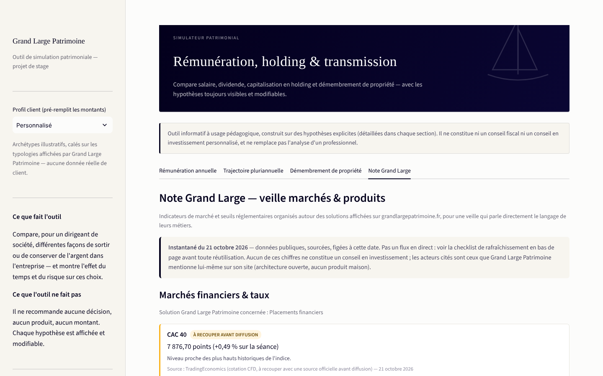

# Simulateur patrimonial — Grand Large Patrimoine

**Rémunération du dirigeant, trajectoire holding, démembrement de propriété et veille marchés — dans un seul outil, avec chaque hypothèse sourcée et modifiable.**

Projet réalisé par Antonin Desmazures pendant un stage chez Happy Capital / My Capital Immo, pour démontrer une approche d'ingénierie patrimoniale à [Grand Large Patrimoine](https://grandlargepatrimoine.fr) (family office, Paris).


---

## Pourquoi cet outil

Un dirigeant de société qui se demande *« salaire ou dividende ? »*, *« je garde l'argent en direct ou je capitalise dans une holding ? »*, *« je transmets en pleine propriété ou en démembrement ? »* a besoin de réponses chiffrées, pas d'approximations. Cet outil répond aux trois questions avec les barèmes fiscaux et sociaux français 2026 réellement appliqués (PASS, abattement forfaitaire, IS, barème IR, barème de l'article 669 du CGI), teste chaque calcul automatiquement, et affiche une veille de marché sourcée et datée plutôt que des chiffres figés dans le code.

**Ce que l'outil ne fait pas** : il ne recommande aucune décision, aucun produit, aucun montant. Chaque hypothèse est affichée et modifiable. Il ne remplace pas l'analyse d'un professionnel — voir [Limites et avertissements](#limites-et-avertissements).

## Les 4 modules

### 1 — Rémunération annuelle
Salaire vs dividende, avec un choix de la forme juridique du dirigeant : SASU (président, assimilé salarié — charges patronales et salariales par tranche de PASS) ou SARL (gérant majoritaire, travailleur non salarié — cotisations TNS, sans distinction patronal/salarial, et réintégration des dividendes excédant 10 % du capital social dans l'assiette des cotisations, article L131-6 du code de la sécurité sociale). Abattement de 10 % pour frais professionnels, IS à 15 %/25 %, barème IR progressif, PFU sur dividendes. Cascade interactive (waterfall) du coût total entreprise jusqu'au net en poche, détail du calcul étape par étape, comparateur direct des 4 scénarios (SASU/SARL × salaire/dividende) sans changer de réglage, export CSV et PDF (synthèse one-pager).

### 2 — Trajectoire pluriannuelle
Garder l'argent en direct vs le faire capitaliser dans une holding, sur plusieurs années. Simulation Monte-Carlo (1500 tirages) avec trois profils de rendement/risque, affichée en fourchette P10–P90 plutôt qu'en point unique — pour ne jamais ressembler à une prévision de performance personnalisée. L'année de croisement (scénario central) est annotée directement sur le graphique.


### 3 — Démembrement de propriété
Donation en pleine propriété vs donation de la nue-propriété (usufruit conservé par le donateur) : barème de l'article 669 du CGI, abattements de donation en ligne directe, calcul exact des droits de donation par tranche. L'abattement de 100 000 € (article 779 du CGI) s'applique par enfant et par parent — l'outil répartit donc la valeur transmise selon le nombre d'enfants et le nombre de parents donateurs, au lieu d'un abattement unique global. Courbe interactive du barème officiel avec le donateur positionné sur sa tranche d'âge.


### 4 — Note Grand Large (veille marchés & produits)
Indicateurs de marché et seuils réglementaires organisés autour des 6 solutions réellement affichées sur grandlargepatrimoine.fr (placements financiers, immobilier, non coté, ingénierie fiscale du dirigeant, transmission), avec source et date pour chaque chiffre, un signal visuel sur les données à recouper avant diffusion, et une checklist de rafraîchissement explicite — ce n'est pas un flux temps réel, c'est un instantané assumé comme tel.



Chaque onglet (sauf la veille) propose aussi un export PDF en plus du CSV, et un glossaire dépliable des termes techniques employés (PASS, TNS, PFU, démembrement, usufruit...), pour un lecteur non-initié.

## Rigueur méthodologique

- **Aucune hypothèse inventée** : chaque seuil fiscal et chaque chiffre de marché est sourcé (CGI, ACPR, ASPIM, France Invest, France Assureurs, Banque de France...), avec sa date de validité.
- **47 tests automatisés** (`tests_sanity.py`) : cas limites, monotonie, cohérence de la dichotomie brut ↔ coût total, reproductibilité de la simulation Monte-Carlo, cohérence du barème de démembrement, répartition de l'abattement de donation par enfant et par parent, et cohérence du régime TNS (SARL) face au régime assimilé salarié (SASU).
- **Compliance-first** : bandeau de non-responsabilité sur chaque onglet, aucune recommandation de produit ou de montant, fourchettes de risque plutôt que performances ponctuelles.
- **Charte graphique réelle** : couleurs et typographie extraites du site de Grand Large Patrimoine (et non inventées), palette de données validée accessibilité (contraste, daltonisme).

## Stack technique

- **Python** (fiscalité, simulation, démembrement, veille) — modules purs, testables indépendamment de l'interface
- **Streamlit** — interface interactive
- **Plotly** — graphiques
- **NumPy / pandas** — simulation Monte-Carlo et tableaux de détail

## Lancer en local

```bash
pip install -r requirements.txt
streamlit run app.py
```

## Structure du repo

```
fiscalite.py          # charges sociales SASU (assimilé salarié), IS, IR, abattement 10 %, dichotomie brut ↔ coût total
fiscalite_tns.py      # cotisations sociales SARL (gérant majoritaire, TNS) et réintégration des dividendes
trajectoire.py       # comparaison directe vs holding, déterministe
simulation.py        # même comparaison, Monte-Carlo (profils prudent/équilibre/dynamique)
demembrement.py       # barème art. 669 CGI, droits de donation, pleine propriété vs démembrement
veille.py             # indicateurs de marché et seuils réglementaires sourcés, organisés par solution GLP
export_pdf.py         # génération des exports PDF one-pager (un par scénario)
glossaire.py          # définitions courtes des termes techniques, affichées par onglet
app.py                # interface Streamlit (4 onglets), charte graphique Grand Large Patrimoine
tests_sanity.py       # 47 vérifications automatisées sur les modules de calcul
```

## Méthodologie — conçu avec Claude (Anthropic)

Ce projet a été construit en travaillant avec Claude du premier au dernier jour : cadrage des hypothèses fiscales, vérification croisée des barèmes et seuils, écriture du code et des tests, extraction de la charte graphique réelle de Grand Large Patrimoine, rédaction du guide pédagogique, recherche et sourcing de la veille marchés, audit visuel automatisé (Playwright) à chaque itération pour repérer les régressions avant livraison. L'objectif : utiliser l'IA comme un collaborateur technique exigeant, pas comme un générateur de texte — chaque chiffre reste vérifiable, chaque hypothèse reste sourcée.

## Limites et avertissements

Outil informatif à usage pédagogique. Il ne constitue ni un conseil fiscal, ni un conseil juridique, ni un conseil en investissement personnalisé, et ne remplace pas l'analyse d'un professionnel. Les données de la « Note Grand Large » sont un instantané daté, pas un flux en temps réel — voir la checklist de rafraîchissement dans l'onglet correspondant avant toute réutilisation.

## Auteur

**Antonin Desmazures** — Master Finance, ESSCA (English track) · [contact](mailto:antodesma@gmail.com)
