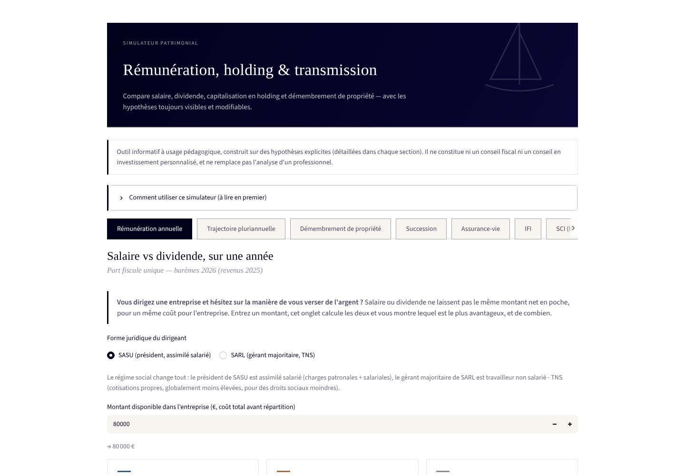
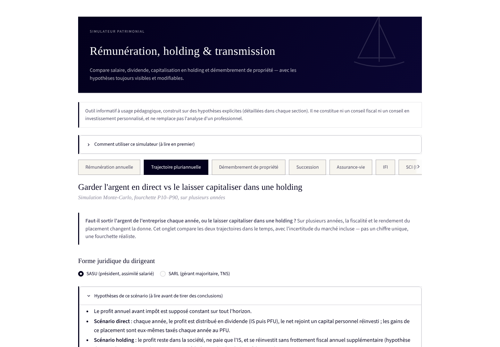
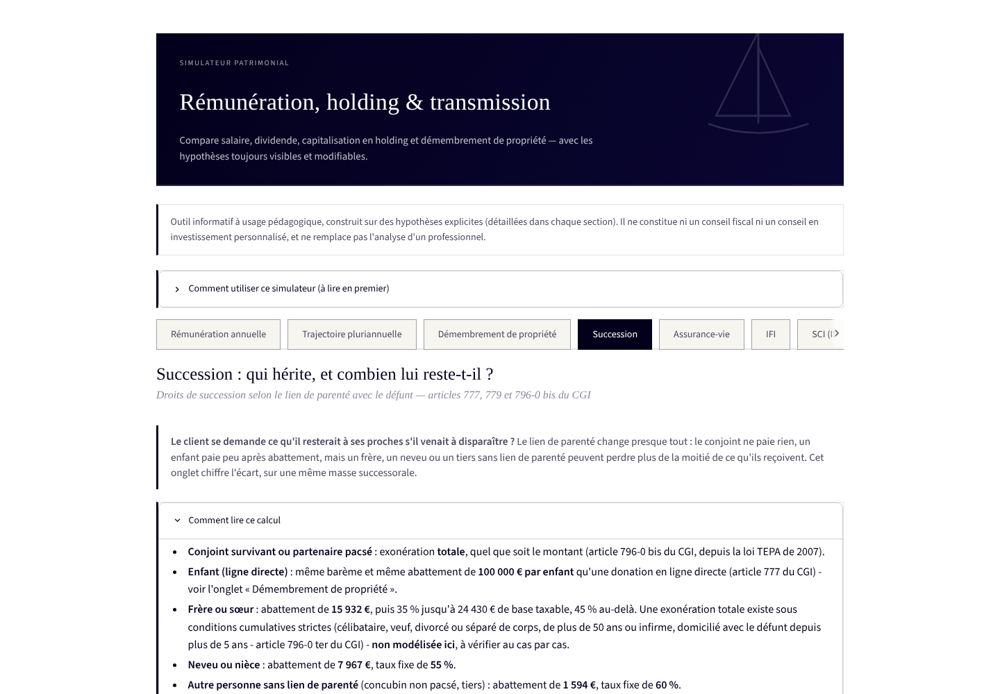
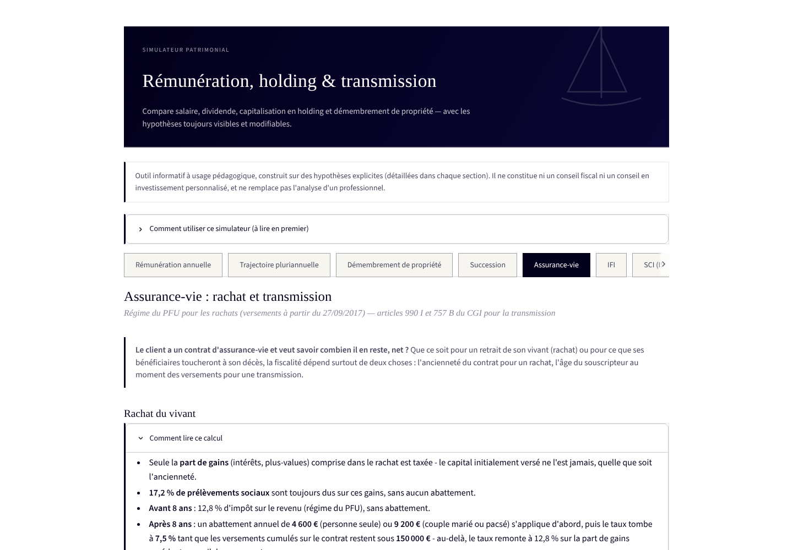
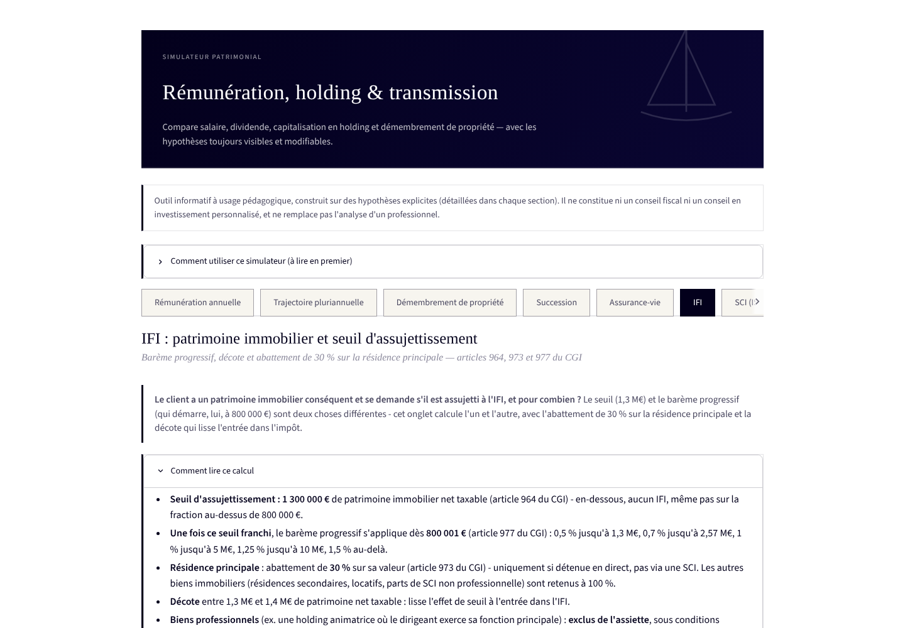

# Simulateur patrimonial — Grand Large Patrimoine

**Rémunération du dirigeant, trajectoire holding, démembrement de propriété, succession, assurance-vie, IFI, SCI (IS vs IR), PER et veille marchés — dans un seul outil, avec chaque hypothèse sourcée et modifiable.**

Projet réalisé par Antonin Desmazures pendant un stage chez Happy Capital / My Capital Immo, pour démontrer une approche d'ingénierie patrimoniale à [Grand Large Patrimoine](https://grandlargepatrimoine.fr) (family office, Paris).



---

## Pourquoi cet outil

Un dirigeant de société qui se demande *« salaire ou dividende ? »*, *« je garde l'argent en direct ou je capitalise dans une holding ? »*, *« je transmets en pleine propriété ou en démembrement ? »* a besoin de réponses chiffrées, pas d'approximations. Cet outil répond aux trois questions avec les barèmes fiscaux et sociaux français 2026 réellement appliqués (PASS, abattement forfaitaire, IS, barème IR, barème de l'article 669 du CGI), teste chaque calcul automatiquement, et affiche une veille de marché sourcée et datée plutôt que des chiffres figés dans le code.

**Ce que l'outil ne fait pas** : il ne recommande aucune décision, aucun produit, aucun montant. Chaque hypothèse est affichée et modifiable. Il ne remplace pas l'analyse d'un professionnel — voir [Limites et avertissements](#limites-et-avertissements).

## Les 9 modules

### 1 — Rémunération annuelle
Salaire vs dividende, avec un choix de la forme juridique du dirigeant : SASU (président, assimilé salarié — charges patronales et salariales par tranche de PASS) ou SARL (gérant majoritaire, travailleur non salarié — cotisations TNS, sans distinction patronal/salarial, et réintégration des dividendes excédant 10 % du capital social dans l'assiette des cotisations, article L131-6 du code de la sécurité sociale). Abattement de 10 % pour frais professionnels, IS à 15 %/25 %, barème IR progressif, PFU sur dividendes. Cascade interactive (waterfall) du coût total entreprise jusqu'au net en poche pour les deux scénarios (salaire et dividende), détail du calcul étape par étape, comparateur direct des 4 scénarios (SASU/SARL × salaire/dividende) sans changer de réglage, export CSV et PDF (synthèse one-pager).

**Optimiseur de répartition** : plutôt que de choisir entre 100 % salaire et 100 % dividende, un balayage exhaustif de toutes les répartitions intermédiaires trouve le point qui laisse le plus de net en poche — parce que les effets de seuil (plafond de la sécurité sociale, tranches de l'IR, seuil de dividende non cotisé en SARL) rendent la fonction non monotone : l'optimum n'est pas toujours à une extrémité.

**Analyse de sensibilité (tornade)** : à répartition optimale, quel paramètre fait le plus bouger le net en poche ? La forme juridique (SASU vs SARL), le taux normal d'IS, et - selon la forme choisie - l'abattement forfaitaire de 10 % (SASU) ou le capital social (SARL) sont testés un par un, à la hausse et à la baisse, toutes choses égales par ailleurs. Chaque variation est un test de robustesse explicitement présenté comme tel, jamais comme une prévision ; quand un paramètre n'a, pour ce scénario précis, aucune prise sur le résultat (ex. le taux d'IS normal quand le dividende optimal reste sous le seuil des 42 500 € taxés à taux réduit), le graphique l'indique clairement plutôt que d'afficher une barre invisible.

### 2 — Trajectoire pluriannuelle
Garder l'argent en direct vs le faire capitaliser dans une holding, sur plusieurs années. Simulation Monte-Carlo (1500 tirages), affichée en fourchette P10–P90 plutôt qu'en point unique — pour ne jamais ressembler à une prévision de performance personnalisée. L'année de croisement (scénario central) est annotée directement sur le graphique.

**Cohérence SASU/SARL avec l'onglet 1** : le même choix de forme juridique du dirigeant s'applique ici. En SARL (gérant majoritaire, TNS), chaque distribution - celle de chaque année comme la sortie finale de la holding, traitée comme une distribution unique l'année de la sortie - suit le même mécanisme de réintégration au-delà de 10 % du capital social + compte courant dans l'assiette des cotisations sociales que sur l'onglet « Rémunération annuelle », avec la même cotisation TNS minimale récurrente. La version Monte-Carlo (vectorisée) de ce calcul est testée pour recouper exactement la version scalaire du module `trajectoire.py`, afin de ne jamais faire diverger les deux.

**Paniers de solutions Grand Large** : plutôt que des profils abstraits ("prudent/équilibré/dynamique" détachés de toute classe d'actifs), la simulation combine les 4 grandes familles de solutions réellement proposées par Grand Large Patrimoine (épargne sécurisée, immobilier patrimonial, placements financiers, investissements non cotés), avec un rendement moyen sourcé par classe (ASPIM, France Assureurs, France Invest/EY), affichée en donut coloré avec le rendement moyen au centre — la répartition entre classes reste une construction pédagogique pour cet outil, explicitement présentée comme telle (encart de compliance dédié), jamais comme la grille de gestion réelle et confidentielle de Grand Large Patrimoine. Un mode "sur mesure" permet de composer sa propre répartition avec 4 curseurs qui se réajustent automatiquement pour toujours sommer à 100 %, et, en option, de remplacer le rendement sourcé d'une classe par sa propre hypothèse (clairement signalée comme telle, jamais confondue avec une donnée de marché). Le graphique de trajectoire se zoome (molette ou barre d'outils) et son infobulle détaille, à chaque année, la médiane et les deux bornes P10/P90 de chaque scénario, dans l'ordre du plus fort au plus faible ; double-cliquer une série dans la légende l'isole (courbe, fourchette et étiquette). Un comparateur optionnel superpose un second panier (en tirets, médianes seulement) pour visualiser directement l'arbitrage risque/rendement entre deux profils. La synthèse PDF téléchargeable embarque le donut de composition et le détail par classe d'actifs, pas seulement le tableau médiane.



### 3 — Démembrement de propriété
Donation en pleine propriété vs donation de la nue-propriété (usufruit conservé par le donateur) : barème de l'article 669 du CGI, abattements de donation en ligne directe, calcul exact des droits de donation par tranche. L'abattement de 100 000 € (article 779 du CGI) s'applique par enfant et par parent — l'outil répartit donc la valeur transmise selon le nombre d'enfants et le nombre de parents donateurs, au lieu d'un abattement unique global. Courbe interactive du barème officiel avec le donateur positionné sur sa tranche d'âge.

**Pacte Dutreil** : pour la transmission d'une entreprise (et non d'un bien), calcul de l'économie de droits permise par l'exonération de 75 % de la valeur transmise (article 787 B du CGI), avec le détail des conditions à vérifier (seuils de détention, durées d'engagement de conservation, fonction de direction) — le module chiffre l'économie *si* les conditions sont réunies, il ne les vérifie pas.


### 4 — Succession
Au décès (hors donation), les droits dus dépendent avant tout du lien de parenté avec le défunt : conjoint survivant ou partenaire pacsé totalement exonéré (article 796-0 bis du CGI), enfant au même barème et au même abattement de 100 000 € qu'une donation en ligne directe (réutilise directement le barème de `demembrement.py` plutôt que d'en dupliquer un second), frère/sœur (abattement de 15 932 €, 35 %/45 %), neveu/nièce (abattement de 7 967 €, taux fixe de 55 %), et tiers sans lien de parenté (abattement de 1 594 €, taux fixe de 60 %). Un graphique en barres horizontales compare, sur une même masse successorale, ce qu'il resterait net selon qui hérite — l'écart entre un conjoint (tout) et un tiers (40 % à peine) est souvent le chiffre qui parle le plus à un client.



### 5 — Assurance-vie
Fiscalité du rachat (retrait du vivant) et de la transmission au décès. Pour un rachat, seule la part de gains comprise dans le retrait est taxée : régime du PFU pour les versements à partir du 27/09/2017 (12,8 % avant 8 ans, 7,5 % après 8 ans dans la limite de 150 000 € de versements cumulés, 12,8 % au-delà), abattement annuel de 4 600 €/9 200 € après 8 ans, et 17,2 % de prélèvements sociaux toujours dus sans abattement. Pour la transmission, c'est l'âge du souscripteur au moment de CHAQUE versement qui détermine le régime applicable : article 990 I avant 70 ans (abattement de 152 500 € par bénéficiaire, puis 20 %/31,25 % selon le seuil de 700 000 €) ou article 757 B après 70 ans (seules les primes versées sont taxables, les gains étant intégralement exonérés, après un abattement de 30 500 € cette fois GLOBAL - partagé entre tous les bénéficiaires - puis taxation du solde au même barème progressif des droits de succession en ligne directe que le module de démembrement et de succession, réutilisé tel quel plutôt que dupliqué).



### 6 — IFI
Impôt sur la fortune immobilière : patrimoine immobilier net taxable (abattement de 30 % sur la résidence principale détenue en direct, dettes déductibles), seuil d'assujettissement de 1 300 000 € (en-deçà, aucun IFI, même pas sur la fraction au-dessus de 800 000 €), barème progressif à 6 tranches (article 977 du CGI) et décote qui lisse l'entrée dans l'impôt entre 1,3 M€ et 1,4 M€. Les biens professionnels (ex. une holding animatrice) sont supposés déjà exclus du montant saisi — ce module ne les qualifie pas lui-même, ce tri restant un sujet à conditions précises et souvent contentieux.



### 7 — SCI (IS vs IR)
Détenir un bien locatif à travers une SCI à l'impôt sur le revenu (transparente, régime des revenus fonciers et des plus-values immobilières des particuliers, sans amortissement mais avec un abattement pour durée de détention qui exonère totalement la plus-value après 22 ans à l'IR et 30 ans pour les prélèvements sociaux) ou à l'impôt sur les sociétés (amortissement du bien déductible chaque année, sans sortie de trésorerie, mais plus-value de cession calculée sur la valeur nette comptable - donc souvent plus élevée pour un bien ancien - et double imposition dès que le résultat est distribué à l'associé, IS puis PFU). Une case à cocher bascule entre distribution immédiate chaque année et capitalisation dans la société (même logique que l'arbitrage holding de l'onglet trajectoire), et le graphique empilé distingue les revenus locatifs cumulés de la plus-value nette de cession pour chaque régime.


### 8 — PER
Verser sur un plan d'épargne retraite plutôt que percevoir en net : troisième levier d'arbitrage de la rémunération du dirigeant, à côté du salaire et du dividende de l'onglet 1. Plafond de déduction des versements volontaires (10 % des revenus professionnels nets dans la limite de 8 PASS pour un salarié/assimilé salarié, 10 % du bénéfice + 15 % supplémentaires entre 1 et 8 PASS - structurellement plus généreux - pour un TNS), économie d'impôt immédiate à la TMI actuelle, puis fiscalité de la sortie en capital : versements déduits taxés au barème IR à la TMI du moment (sans prélèvements sociaux) ou totalement exonérés si non déduits, gains toujours taxés au PFU de 31,4 %. Comparateur direct avec l'alternative "encaisser en net tout de suite, puis placer" à montant brut identique.


### 9 — Note Grand Large (veille marchés & produits)
Indicateurs de marché et seuils réglementaires organisés autour des 6 solutions réellement affichées sur grandlargepatrimoine.fr (placements financiers, immobilier, non coté, ingénierie fiscale du dirigeant, transmission), avec source et date pour chaque chiffre, un signal visuel sur les données à recouper avant diffusion, une ligne "en rendez-vous" par indicateur (ce qu'il change concrètement face à un client), et une checklist de rafraîchissement explicite — ce n'est pas un flux temps réel, c'est un instantané assumé comme tel. Une "règle fiscale niche du jour" (mécanismes patrimoniaux stables et sourcés, choisis pour être souvent mal connus plutôt que pour leur actualité) complète la page en rotation quotidienne.


Chaque onglet (sauf la veille) propose aussi un export PDF en plus du CSV, et un glossaire dépliable des termes techniques employés (PASS, TNS, PFU, démembrement, usufruit, article 990 I, article 757 B, lien de parenté, IFI, décote, PER, TMI...), pour un lecteur non-initié.

## Rigueur méthodologique

- **Aucune hypothèse inventée** : chaque seuil fiscal et chaque chiffre de marché est sourcé (CGI, ACPR, ASPIM, France Invest, France Assureurs, Banque de France...), avec sa date de validité.
- **146 tests automatisés** (`tests_sanity.py`) : cas limites, monotonie, cohérence de la dichotomie brut ↔ coût total, reproductibilité de la simulation Monte-Carlo, cohérence du barème de démembrement, répartition de l'abattement de donation par enfant et par parent, cohérence du régime TNS (SARL) face au régime assimilé salarié (SASU) sur la rémunération annuelle ET sur la trajectoire pluriannuelle (recoupement exact entre la version scalaire et la version vectorisée Monte-Carlo), exactitude de l'optimiseur de répartition (recoupement exact avec les scénarios purs aux deux extrémités), cohérence de l'analyse de sensibilité (tri par amplitude, recoupement avec l'optimiseur), cohérence du calculateur Pacte Dutreil (conservation de la valeur, économie strictement positive), cohérence des paniers de solutions (répartitions qui somment à 100 %, rendement pondéré correct, normalisation d'une saisie imparfaite), cohérence de la fiscalité de l'assurance-vie (rachat : seuils de 8 ans et de 150 000 € de versements, abattements annuels, prélèvements sociaux toujours dus ; transmission : bascule 990 I / 757 B selon l'âge au versement, répartition de l'abattement 757 B entre bénéficiaires, exonération totale des gains sous ce régime), cohérence des droits de succession par lien de parenté (exonération totale du conjoint, abattements et barèmes propres à chaque lien, classement croissant des droits dus du conjoint vers le tiers sans lien de parenté), cohérence de l'IFI (seuil d'assujettissement distinct du début du barème, valeurs de référence de la décote à 1,3/1,35/1,4 M€, effet de l'abattement de 30 % sur la résidence principale), cohérence de la comparaison SCI à l'IS vs à l'IR (exonération totale de la plus-value après 22 ans à l'IR et 30 ans pour les prélèvements sociaux, rythme d'abattement plus lent sur les prélèvements sociaux que sur l'IR, capitalisation sans double imposition tant que le résultat n'est pas distribué à l'IS, cohérence du total perçu avec la somme des revenus cumulés et de la plus-value nette), et cohérence du PER (plafond de déduction salarié vs TNS conforme aux valeurs de référence sourcées, plancher et plafond bien appliqués, fiscalité de sortie - versements exonérés si non déduits, gains toujours au PFU - et avantage du PER strictement positif à TMI identique entre l'entrée et la sortie, renforcé quand la TMI de sortie est inférieure).
- **Compliance-first** : bandeau de non-responsabilité sur chaque onglet, aucune recommandation de produit ou de montant, fourchettes de risque plutôt que performances ponctuelles.
- **Charte graphique réelle** : couleurs et typographie extraites du site de Grand Large Patrimoine (et non inventées), palette de données validée accessibilité (contraste, daltonisme).

## Stack technique

- **Python** (fiscalité, simulation, démembrement, veille) — modules purs, testables indépendamment de l'interface
- **Streamlit** — interface interactive
- **Plotly** — graphiques
- **NumPy / pandas** — simulation Monte-Carlo et tableaux de détail

## Lancer en local

```bash
pip install -r requirements.txt
streamlit run app.py
```

## Structure du repo

```
fiscalite.py          # charges sociales SASU (assimilé salarié), IS, IR, abattement 10 %, dichotomie brut ↔ coût total
fiscalite_tns.py      # cotisations sociales SARL (gérant majoritaire, TNS) et réintégration des dividendes
optimisation.py       # optimiseur de répartition salaire/rémunération vs dividende (balayage exhaustif)
trajectoire.py       # comparaison directe vs holding, déterministe
simulation.py        # même comparaison, Monte-Carlo (rendement/volatilité en paramètres)
paniers.py            # paniers de solutions GLP (épargne, immobilier, actions, non coté) pour la simulation
demembrement.py       # barème art. 669 CGI, droits de donation, pleine propriété vs démembrement
pacte_dutreil.py      # exonération Dutreil (art. 787 B CGI) pour la transmission d'entreprise
succession.py         # droits de succession par lien de parenté (conjoint, enfant, frère/sœur, neveu, tiers)
assurance_vie.py      # rachat (régime du PFU) et transmission (art. 990 I / 757 B du CGI) en assurance-vie
ifi.py                # impôt sur la fortune immobilière (barème, décote, abattement résidence principale)
sci.py                # SCI à l'IS vs à l'IR (revenus fonciers, amortissement, plus-value de cession)
per.py                # PER (plafond de déduction, économie d'impôt, fiscalité de sortie en capital)
veille.py             # indicateurs de marché et seuils réglementaires sourcés, organisés par solution GLP
regle_fiscale.py      # catalogue de mécanismes patrimoniaux niches, rotation quotidienne déterministe
export_pdf.py         # génération des exports PDF one-pager (un par scénario)
glossaire.py          # définitions courtes des termes techniques, affichées par onglet
app.py                # interface Streamlit (9 onglets), charte graphique Grand Large Patrimoine
tests_sanity.py       # 146 vérifications automatisées sur les modules de calcul
```

## Méthodologie — conçu avec Claude (Anthropic)

Ce projet a été construit en travaillant avec Claude du premier au dernier jour : cadrage des hypothèses fiscales, vérification croisée des barèmes et seuils, écriture du code et des tests, extraction de la charte graphique réelle de Grand Large Patrimoine, rédaction du guide pédagogique, recherche et sourcing de la veille marchés, audit visuel automatisé (Playwright) à chaque itération pour repérer les régressions avant livraison. L'objectif : utiliser l'IA comme un collaborateur technique exigeant, pas comme un générateur de texte — chaque chiffre reste vérifiable, chaque hypothèse reste sourcée.

## Limites et avertissements

Outil informatif à usage pédagogique. Il ne constitue ni un conseil fiscal, ni un conseil juridique, ni un conseil en investissement personnalisé, et ne remplace pas l'analyse d'un professionnel. Les données de la « Note Grand Large » sont un instantané daté, pas un flux en temps réel — voir la checklist de rafraîchissement dans l'onglet correspondant avant toute réutilisation.

## Auteur

**Antonin Desmazures** — Master Finance, ESSCA (English track) · [contact](mailto:antodesma@gmail.com)
